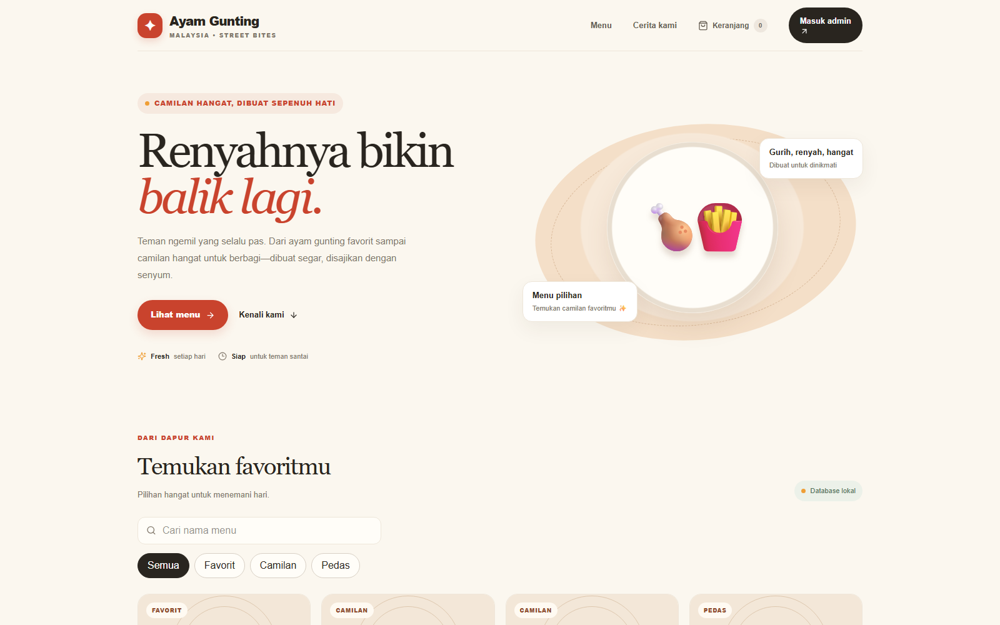
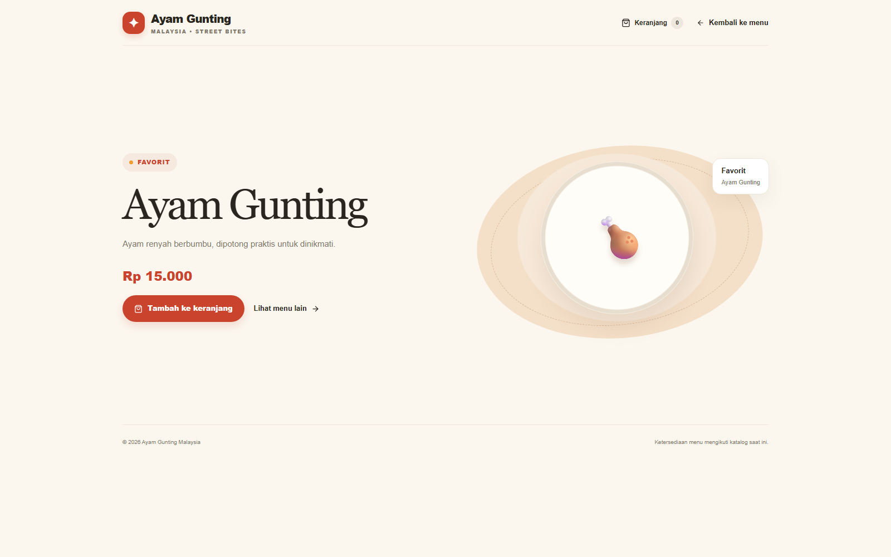
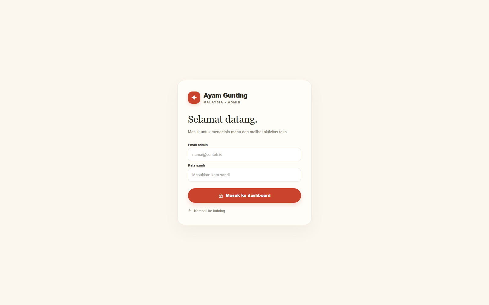
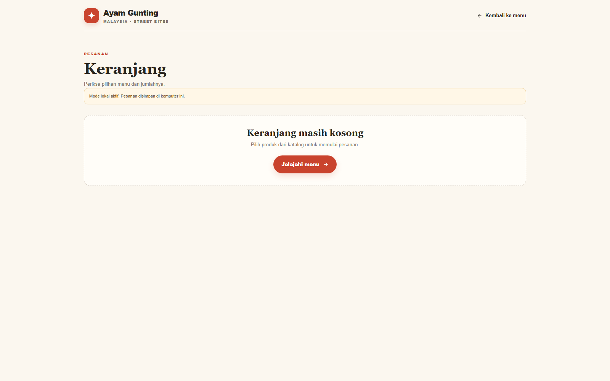
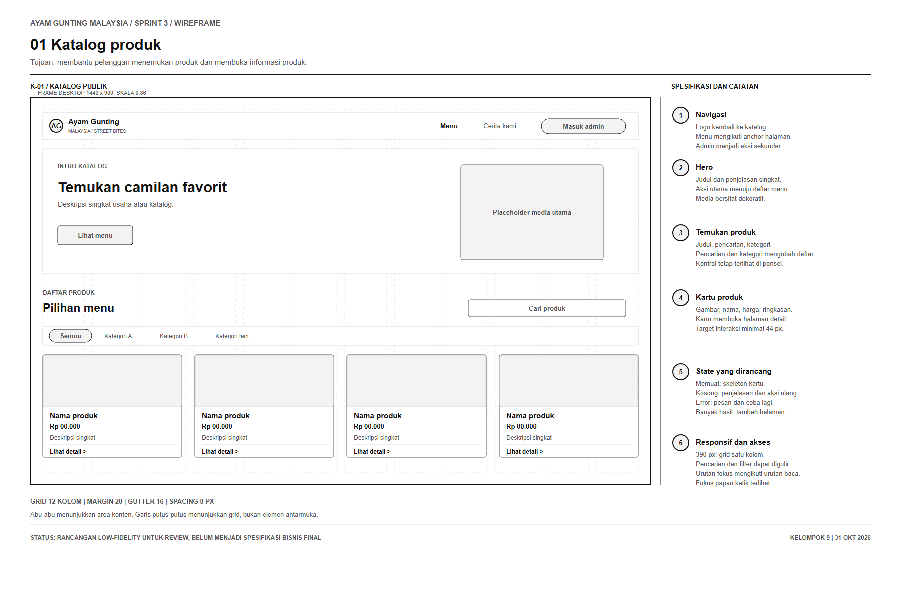
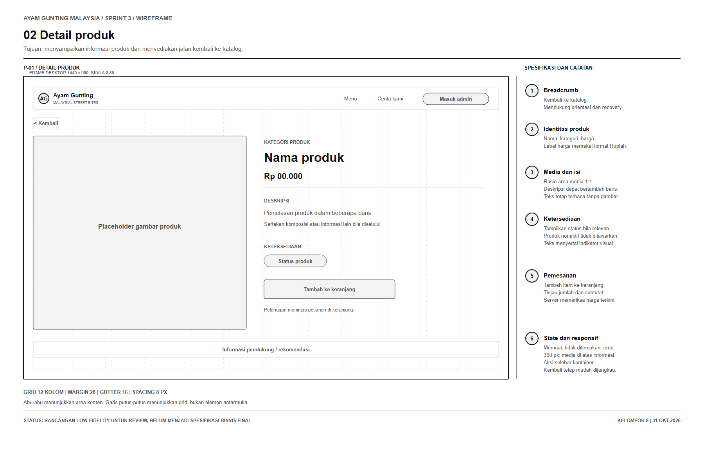
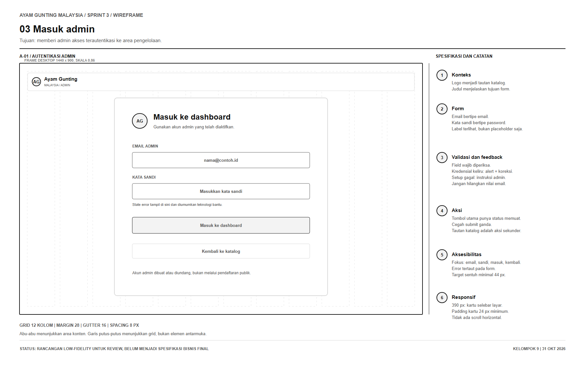
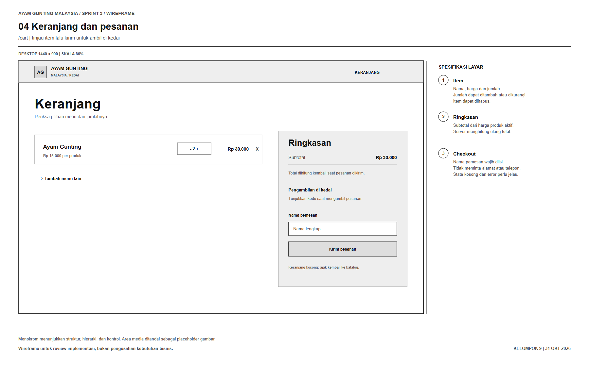
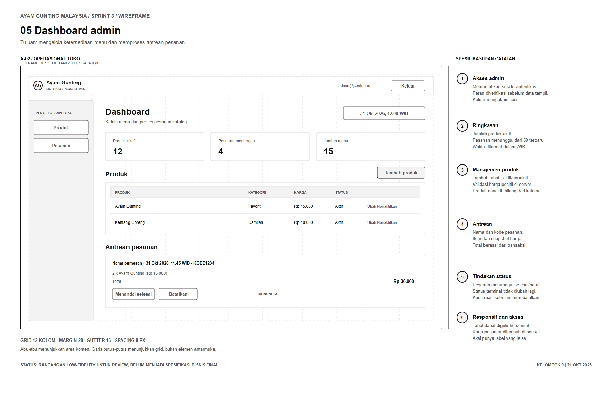

# Laporan Pelaksanaan Sprint 3

## Identitas proyek

| Komponen | Keterangan |
|---|---|
| Nama proyek | Sistem Informasi Penjualan dan Manajemen Produk UMKM Ayam Gunting Malaysia |
| Mata kuliah | Manajemen Proyek Perangkat Lunak |
| Kelompok | 9 |
| Periode Sprint 3 pada baseline | 9–20 November 2026 |
| Tanggal pemeriksaan dokumen | 31 Oktober 2026 |
| Repository | [MPPL01022026/kelompok-9](https://github.com/MPPL01022026/kelompok-9) |

## Ringkasan

Pada 31 Oktober 2026, repository berisi prototipe lokal MVP yang menghubungkan katalog produk, keranjang, pengiriman pesanan untuk diambil di kedai, serta dashboard operasional admin. Mode lokal menyimpan katalog, pesanan, item, dan status pada berkas JSON di komputer pengembang. Pengelola dapat menambah, mengubah, dan menonaktifkan produk, kemudian menandai pesanan sebagai selesai atau batal. Zona waktu tampilan operasional menggunakan WIB.

Prototipe mencatat nama pemesan sebagai satu-satunya identitas pelanggan. Sistem tidak meminta nomor telepon, alamat, ataupun pembayaran daring. Harga dan nama produk disalin ke setiap item pesanan pada saat pemesanan, sedangkan total dihitung ulang di sisi server. Sumber data lokal belum disinkronkan antarperangkat dan tidak ditujukan untuk operasional publik.

Tanggal pemeriksaan dokumen mendahului periode Sprint 3 pada baseline proyek. Karena itu, isi berikut merupakan laporan kondisi implementasi prototipe saat ini, bukan klaim bahwa kegiatan sprint, rapat, persetujuan pemilik usaha, atau uji penerimaan telah berlangsung. Koneksi Supabase belum dikonfigurasi dan migrasi SQL belum dijalankan pada proyek Supabase.

## 1. Tujuan dan ruang lingkup MVP

MVP memusatkan pekerjaan pada alur pelanggan dan operasi kedai berikut.

| Area | Lingkup implementasi |
|---|---|
| Katalog | Menampilkan produk aktif, pencarian, filter kategori, dan halaman detail |
| Keranjang | Menambah produk, memperbarui jumlah, menghapus item, serta melihat subtotal |
| Pemesanan | Mengirim pesanan dengan nama pemesan untuk pengambilan di kedai |
| Data pesanan | Mencatat nama, waktu, status, item, kuantitas, snapshot nama dan harga produk, serta total |
| Operasi admin | Login lokal berbasis kredensial lingkungan, CRUD produk, perubahan ketersediaan, dan pengelolaan antrean |
| Status pesanan | Status awal menunggu, kemudian dapat diubah menjadi selesai atau dibatalkan |
| Waktu | Waktu sistem disimpan dalam ISO UTC dan ditampilkan dalam zona Asia/Jakarta |
| Di luar lingkup | Pembayaran daring, pengantaran, laporan analitik, serta penyimpanan nomor telepon atau alamat |

## 2. Hasil implementasi yang tersedia

| Kode backlog | Hasil pada prototipe lokal | Status pemeriksaan kode |
|---|---|---|
| PB-01 | Katalog, pencarian, kategori, state kosong, dan data produk lokal | Implementasi tersedia; pemeriksaan otomatis tercatat pada Bagian 6 |
| PB-02 | Detail produk, penambahan ke keranjang, dan penyimpanan keranjang pada browser | Implementasi tersedia; alur database hosted belum diperiksa |
| PB-03 | Login/logout admin menggunakan kredensial pada `.env.local` | Implementasi mode lokal tersedia; pengujian alur sesi belum dicatat |
| PB-04/PB-05 | Tambah, ubah, aktifkan, dan nonaktifkan produk | Implementasi lokal tersedia |
| PB-06 | Pemesanan lokal, snapshot produk/harga, total server, tanda terima, dan status antrean | Implementasi lokal tersedia |
| Migrasi hosted | Berkas SQL gabungan untuk skema awal dan operasi MVP | Disiapkan untuk ditinjau dan diimpor ke Supabase; belum dijalankan |

Data awal katalog adalah data contoh aplikasi. Nama produk dan harga perlu diverifikasi pemilik usaha sebelum dipakai sebagai katalog resmi.

## 3. Arsitektur dan pengelolaan data

Aplikasi menggunakan Next.js, TypeScript, dan Supabase client untuk jalur integrasi hosted. Dalam mode tanpa konfigurasi Supabase, aplikasi membaca dan memperbarui `app/.local-data/store.json`. Berkas data lokal dikecualikan dari Git. Sesi admin lokal menggunakan cookie `HttpOnly` dan kata sandi dari environment. Keranjang menyimpan ID produk dan jumlah pada penyimpanan browser; nama pelanggan hanya dikirim ketika pesanan dibuat.

Untuk menyiapkan aplikasi lokal, salin `app/.env.example` ke `app/.env.local`, ubah `LOCAL_ADMIN_PASSWORD`, jalankan dependensi dengan pnpm, kemudian jalankan server pengembangan dari folder `app/`. Kredensial contoh pada `.env.example` tidak boleh dipakai untuk deployment.

Untuk integrasi hosted, berkas [IMPORT_TO_SUPABASE.sql](../../app/supabase/IMPORT_TO_SUPABASE.sql) berisi migrasi awal dan migrasi MVP dalam urutan yang diperlukan. Terapkan hanya pada project Supabase yang tepat setelah meninjau skema, kebijakan akses, serta prosedur pemulihan. Setelah impor, isi URL dan anon key di environment aplikasi, buat akun melalui Supabase Auth, lalu daftarkan ID pengguna pada `admin_users`.

Mode JSON lokal sesuai untuk demonstrasi pada satu komputer. Mode ini tidak memiliki sinkronisasi, pencadangan terjadwal, kontrol akses multi-admin, atau perlindungan tulis yang dirancang untuk lingkungan produksi. Penerapan publik harus menggunakan database terkelola dan mitigasi spam pada endpoint pemesanan.

## 4. Bukti kontribusi yang tercatat

Riwayat repository mencatat pekerjaan persiapan yang telah digabung sebelum prototipe MVP ini.

| Anggota | Kontribusi pada riwayat `main` | Bukti |
|---|---|---|
| Faiza Rahmatika | Fondasi Next.js, konfigurasi, klien Supabase, halaman awal, login admin, dan migrasi awal | [PR #10](https://github.com/MPPL01022026/kelompok-9/pull/10), commit [`8e1f53a`](https://github.com/MPPL01022026/kelompok-9/commit/8e1f53a) |
| Niluh Naswa Salfa Adlian Lubis | Katalog dan detail produk dengan sumber Supabase dan data contoh | [PR #11](https://github.com/MPPL01022026/kelompok-9/pull/11), commit [`a48933a`](https://github.com/MPPL01022026/kelompok-9/commit/a48933a) |
| Zahra, NIM 230504047 | Navigasi mobile, fokus papan ketik, dan preferensi pengurangan gerakan | [PR #12](https://github.com/MPPL01022026/kelompok-9/pull/12), commit [`f766632`](https://github.com/MPPL01022026/kelompok-9/commit/f766632) |
| Nayla Salsabila Awika | Koordinasi dan dokumentasi proyek | Dokumen kendali pada `docs/` |

Perubahan MVP dan laporan terbaru masih berada di lingkungan kerja lokal ketika dokumen ini disusun. Tabel ini tidak menyatakan bahwa perubahan MVP sudah dikirim, ditinjau, atau digabung ke GitHub.

## 5. Tampilan aplikasi dan wireframe

Tangkapan layar aplikasi lokal memperlihatkan data katalog contoh dan status halaman pada saat pengambilan. Gambar ini merupakan bukti tampilan, bukan hasil uji penerimaan. Pratinjau keranjang berikut menunjukkan keadaan kosong; tangkapan layar dasbor operasional belum dibuat.

### 5.1 Katalog dan detail produk

### 5.2 Login admin

### 5.3 Keranjang kosong

### 5.3 Wireframe

Wireframe menggunakan frame desktop 1440 × 900, grid 12 kolom, margin 28 piksel, gutter 16 piksel, dan sistem jarak kelipatan 8 piksel. Setiap halaman dilengkapi anotasi hierarki, interaksi, state, responsivitas 390 piksel, dan aksesibilitas. SVG merupakan sumber yang dapat disunting; PNG merupakan pratinjau.

#### Katalog publik

#### Detail produk

#### Login admin

#### Keranjang dan pesanan

#### Dashboard admin

## 6. Pemeriksaan teknis

| Pemeriksaan | Hasil | Batas pemeriksaan |
|---|---|---|
| ESLint langsung melalui executable lokal | Lulus | Lint kode; tidak menguji perilaku browser |
| TypeScript `tsc --noEmit` | Lulus | Pemeriksaan tipe; tidak menguji database |
| Next.js production build | Lulus setelah perubahan mode penyimpanan JSON pada 31 Oktober 2026 | Build memeriksa kompilasi, bukan integrasi Supabase |
| Route smoke check | Katalog, detail, keranjang, login admin, dan tanda terima memberi HTTP 200 pada 31 Oktober 2026 | Pemeriksaan respons halaman; belum menjalankan submit pesanan lewat browser |
| pnpm lint/build | Terhenti sebelum script karena wrapper pnpm menunggu persetujuan build `unrs-resolver@1.12.2` | Tidak mengubah kebijakan persetujuan paket |
| Migrasi pada Supabase | Belum dijalankan | Tidak ada environment Supabase pada mesin pemeriksaan |
| Alur JSON lokal end-to-end | Belum dicatat | Perlu uji browser atas submit pesanan dan perubahan status admin |
| Pengujian perangkat dan penerimaan stakeholder | Belum dicatat | Jadwalkan pada kegiatan review yang sebenarnya |

## 7. Risiko dan tindak lanjut

| Tindak lanjut | Alasan | Pemilik usulan |
|---|---|---|
| Jalankan ulang lint, pemeriksaan tipe, production build, dan smoke test setelah perubahan lokal final | Memastikan mode file JSON dan autentikasi lokal terintegrasi | Faiza |
| Coba alur pemesanan lokal dari katalog sampai dashboard | Membuktikan penyimpanan dan perubahan status pada satu komputer | Niluh dan Faiza |
| Tinjau migrasi gabungan pada project Supabase development | Mengonfirmasi sintaks, RLS, fungsi RPC, dan kecocokan schema | Faiza; Zahra meninjau model |
| Konfirmasi daftar produk, harga, masa simpan nama pemesan, dan aturan pengambilan | Data dan aturan bisnis tetap memerlukan validasi pemilik usaha | Nayla dan pemilik usaha |
| Tambahkan perlindungan spam sebelum endpoint hosted dibuka untuk publik | RPC pemesanan publik saat ini belum menerapkan rate limit atau CAPTCHA | Faiza |
| Catat rapat Sprint 3, hasil review, PR, dan keputusan dosen setelah kegiatan berlangsung | Bukti tersebut belum tersedia pada tanggal laporan | Nayla dan seluruh tim |

## 8. Referensi repository

- [Pelacak Sprint](../SPRINT_TRACKER.md)
- [Tumpukan pekerjaan proyek](../PROJECT_BACKLOG.md)
- [Pertanyaan terbuka](../OPEN_QUESTIONS.md)
- [Rencana Sprint 3](SPRINT_PLAN.md)
- [Serah terima implementasi](IMPLEMENTATION_HANDOFF.md)
