# Laporan Pelaksanaan Sprint 3

## Identitas proyek

| Komponen | Keterangan |
|---|---|
| Nama proyek | Sistem Informasi Penjualan dan Manajemen Produk UMKM Ayam Gunting Malaysia |
| Mata kuliah | Manajemen Proyek Perangkat Lunak |
| Kelompok | 9 |
| Periode Sprint 3 | 9-20 November 2026 |
| Tanggal pembaruan laporan | 31 Oktober 2026 |
| Repository | [MPPL01022026/kelompok-9](https://github.com/MPPL01022026/kelompok-9) |

## Ringkasan

Laporan ini mencatat kondisi MVP yang tersedia pada repository dan lingkungan kerja per 31 Oktober 2026 sebagai bahan awal pelaksanaan Sprint 3. Periode Sprint 3 dijadwalkan pada 9-20 November 2026. Oleh karena itu, dokumen ini tidak mengatasnamakan kegiatan sprint, rapat, persetujuan stakeholder, atau uji penerimaan yang belum berlangsung.

MVP menyediakan etalase produk, katalog dengan pencarian dan kategori, detail produk, keranjang, pesanan untuk diambil di kedai, tanda terima berkode, login admin, pengelolaan menu, dan antrean pesanan. Mode demonstrasi lokal menyimpan data di berkas JSON pada satu komputer. Pengelola dapat menambah, mengubah, mengaktifkan, dan menonaktifkan produk serta mengubah status pesanan. Waktu operasional ditampilkan dalam zona Asia/Jakarta.

Pelanggan hanya diminta mengisi nama. Aplikasi tidak menangani pembayaran daring, alamat, nomor telepon, ataupun pengantaran. Data katalog pada tangkapan layar merupakan data contoh. Validasi katalog dan aturan usaha dengan pemilik tetap diperlukan sebelum penggunaan operasional.

<!-- pagebreak -->

## 1. Tujuan dan ruang lingkup MVP

MVP mencakup alur pemilihan produk, pemesanan untuk pengambilan di kedai, dan pengelolaan dasar oleh admin.

| Area | Cakupan yang tersedia |
|---|---|
| Katalog publik | Daftar produk aktif, pencarian, filter kategori, informasi produk, dan halaman detail |
| Keranjang | Tambah produk, ubah kuantitas, hapus item, tampilkan subtotal, dan state keranjang kosong |
| Pemesanan | Kirim nama pemesan dan daftar item untuk pengambilan di kedai |
| Data transaksi | Nama, waktu, status, item, kuantitas, snapshot nama dan harga produk, serta total |
| Operasi admin | Login, logout, tambah dan ubah produk, pengaturan ketersediaan, serta antrean pesanan |
| Status pesanan | Status awal menunggu dan tindakan untuk menyelesaikan atau membatalkan pesanan |
| Di luar cakupan | Pembayaran daring, pengantaran, alamat, nomor telepon, analitik, dan sinkronisasi data lokal antarperangkat |

## 2. Hasil implementasi

| Cerita/backlog | Hasil implementasi yang tersedia | Batas yang diketahui |
|---|---|---|
| PB-01 | Etalase dan katalog dengan pencarian, kategori, data produk, serta state kosong | Isi katalog dan harga masih data contoh |
| PB-02 | Detail produk dan keranjang browser dengan pengelolaan kuantitas | Harga diperiksa kembali dari sumber data saat pesanan dibuat |
| PB-03 | Login dan logout admin lokal berbasis kredensial environment | Kredensial lokal hanya untuk penggunaan development |
| PB-04/PB-05 | Form tambah/ubah produk dan pengaturan aktif/nonaktif | Proses bisnis tetap perlu ditinjau pemilik |
| PB-06 | Pembuatan pesanan, snapshot harga/item, tanda terima, dan antrean admin | Pemesanan lokal hanya tersimpan di komputer yang menjalankan aplikasi |
| Integrasi hosted | Migrasi SQL gabungan tersedia untuk ditinjau dan diimpor ke Supabase | Migrasi belum diterapkan pada project Supabase |

Produk contoh yang terlihat pada katalog adalah Ayam Gunting, Kentang Goreng, Chicken Ball, dan Fire Chicken Wings. Nama serta harga pada contoh tidak dinyatakan sebagai daftar harga resmi.

## 3. Arsitektur dan pengelolaan data

Aplikasi dibangun menggunakan Next.js dan TypeScript. Jika Supabase belum dikonfigurasi, data katalog dan pesanan dibaca serta diperbarui melalui `app/.local-data/store.json`. Berkas tersebut dikecualikan dari Git. Keranjang pelanggan menyimpan ID produk dan jumlah di browser. Server mengambil ulang harga dan nama produk ketika pesanan dibuat, lalu menyimpan snapshot item transaksi.

Login admin lokal memakai `LOCAL_ADMIN_EMAIL` dan `LOCAL_ADMIN_PASSWORD` dari `app/.env.local`. Berkas tersebut tidak disertakan dalam laporan. Untuk menjalankan aplikasi, salin `app/.env.example` ke `app/.env.local`, atur kata sandi lokal, pasang dependensi dari folder `app/`, lalu jalankan server development.

Berkas [IMPORT_TO_SUPABASE.sql](../../app/supabase/IMPORT_TO_SUPABASE.sql) menggabungkan skema awal dan operasi MVP. Sebelum dipakai, tinjau kebijakan Row Level Security, fungsi transaksi, akun admin, dan prosedur pemulihan pada project development yang tepat. Endpoint pemesanan hosted juga memerlukan perlindungan spam sebelum digunakan oleh publik.

## 4. Kontribusi dan riwayat repository

Riwayat Git mencatat empat pull request MVP telah digabung ke `main`. Tangkapan layar dan wireframe dalam laporan ini diambil dari aplikasi pada lingkungan kerja lokal setelah penyesuaian antarmuka terbaru. Penyesuaian lokal yang belum masuk ke riwayat Git tidak dianggap sebagai perubahan yang telah digabung.

| Anggota | Kontribusi tercatat | Bukti riwayat |
|---|---|---|
| Faiza Rahmatika | Penyimpanan lokal, validasi server, operasi admin, dan skema Supabase | [PR #14](https://github.com/MPPL01022026/kelompok-9/pull/14) |
| Niluh Naswa Salfa Adlian Lubis | Katalog pelanggan, detail produk, keranjang, dan alur pemesanan | [PR #15](https://github.com/MPPL01022026/kelompok-9/pull/15) |
| Zahra, NIM 230504047 | Antarmuka responsif, aksesibilitas, dan penyempurnaan wireframe | [PR #16](https://github.com/MPPL01022026/kelompok-9/pull/16) |
| Nayla Salsabila Awika | Koordinasi dan dokumentasi MVP | [PR #17](https://github.com/MPPL01022026/kelompok-9/pull/17) |

## 5. Tangkapan layar aplikasi

Gambar diambil dari aplikasi lokal pada 31 Oktober 2026. Isi katalog dan antrean merupakan data contoh untuk memperlihatkan tampilan. Gambar menunjukkan halaman aktual, bukan hasil uji penerimaan stakeholder. Foto makanan adalah ilustrasi dan bukan dokumentasi produk dari kedai.

### 5.1 Beranda dan katalog

#### Beranda etalase

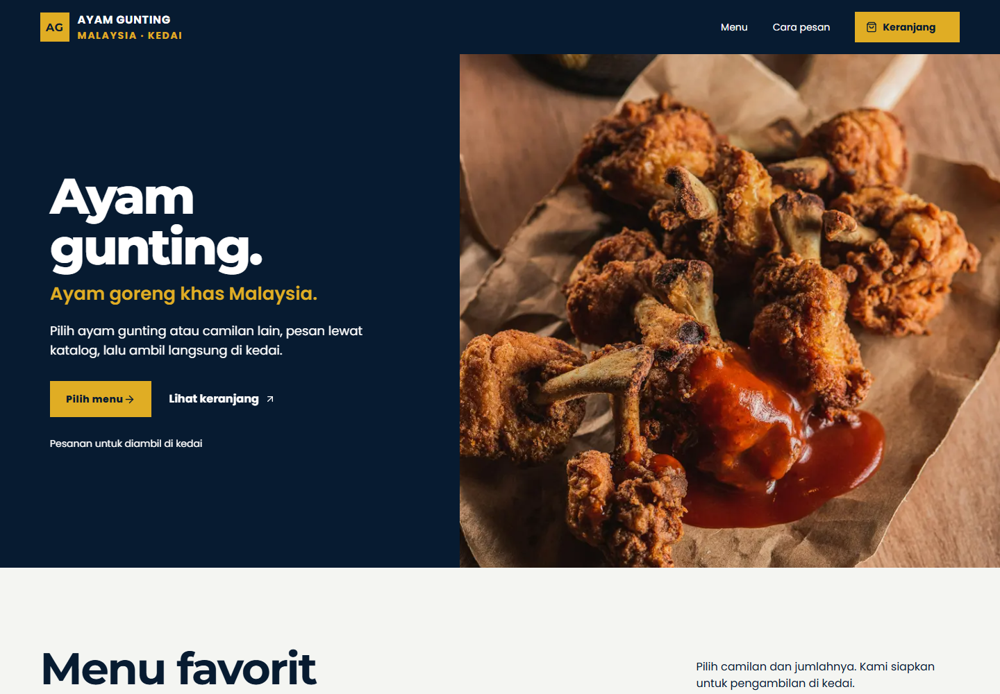

#### Katalog produk

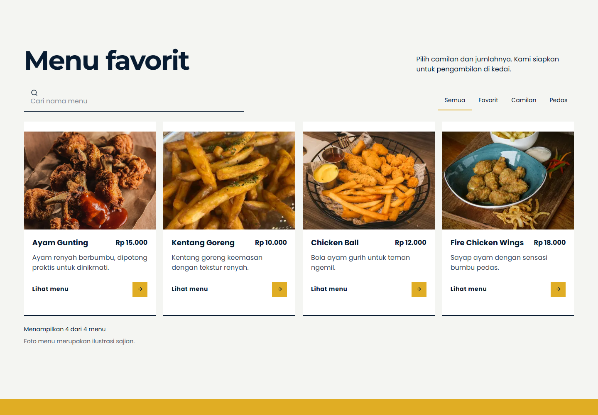

#### Katalog pada layar ponsel

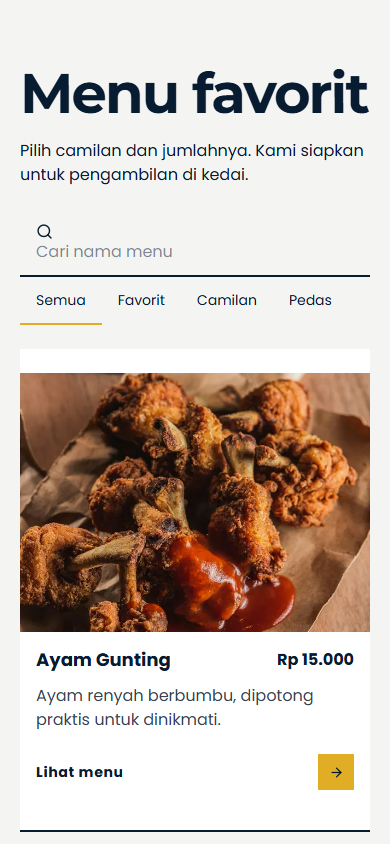

### 5.2 Detail produk

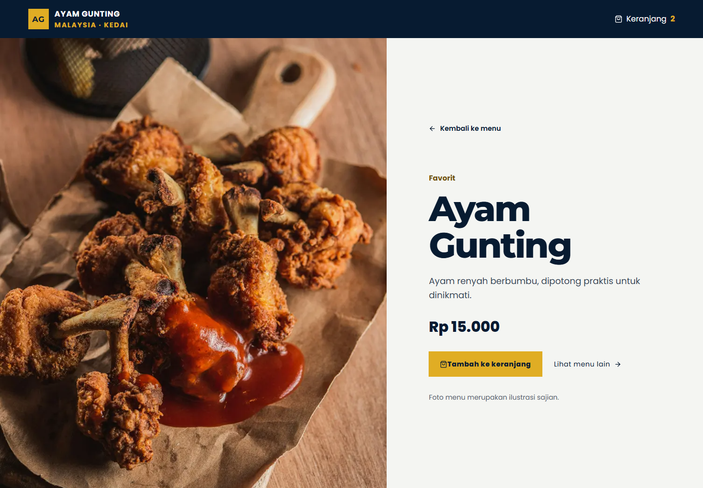

### 5.3 Keranjang dan konfirmasi

#### State kosong

#### Keranjang berisi

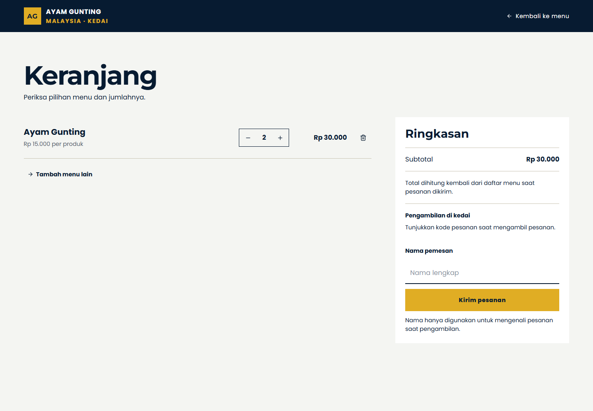

#### Tanda terima

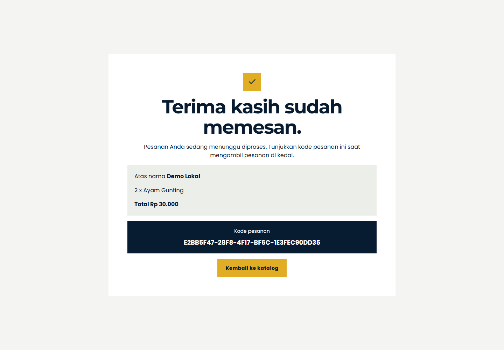

### 5.4 Operasi admin

#### Login admin

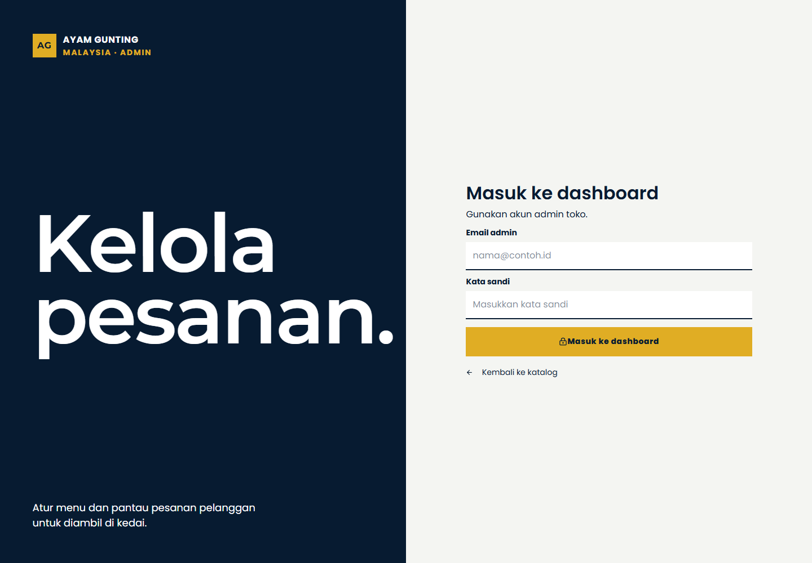

#### Dashboard dan produk

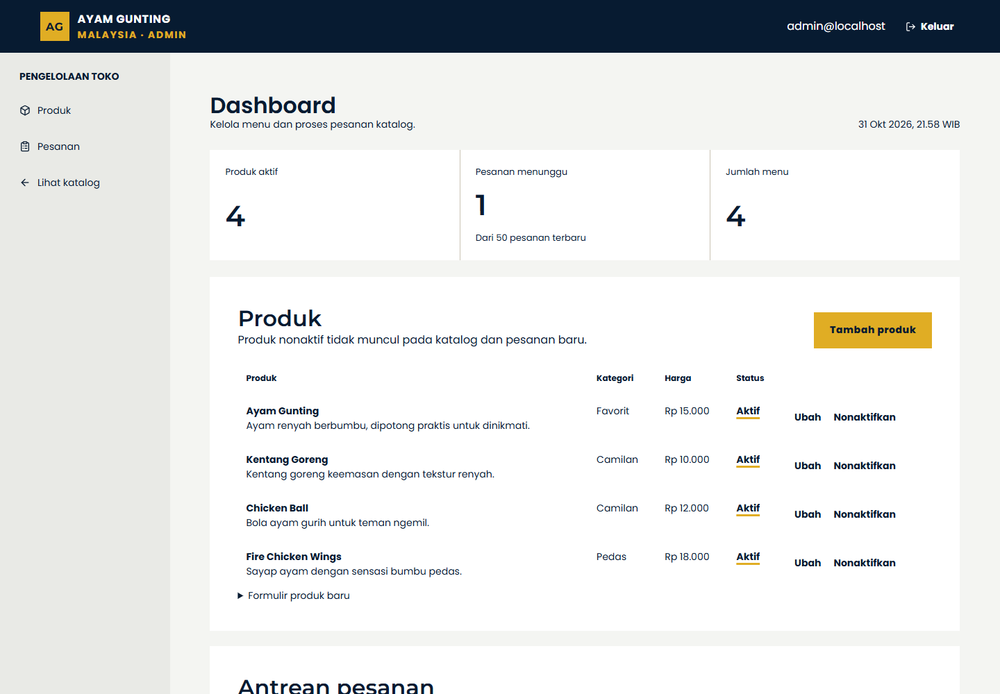

#### Antrean pesanan

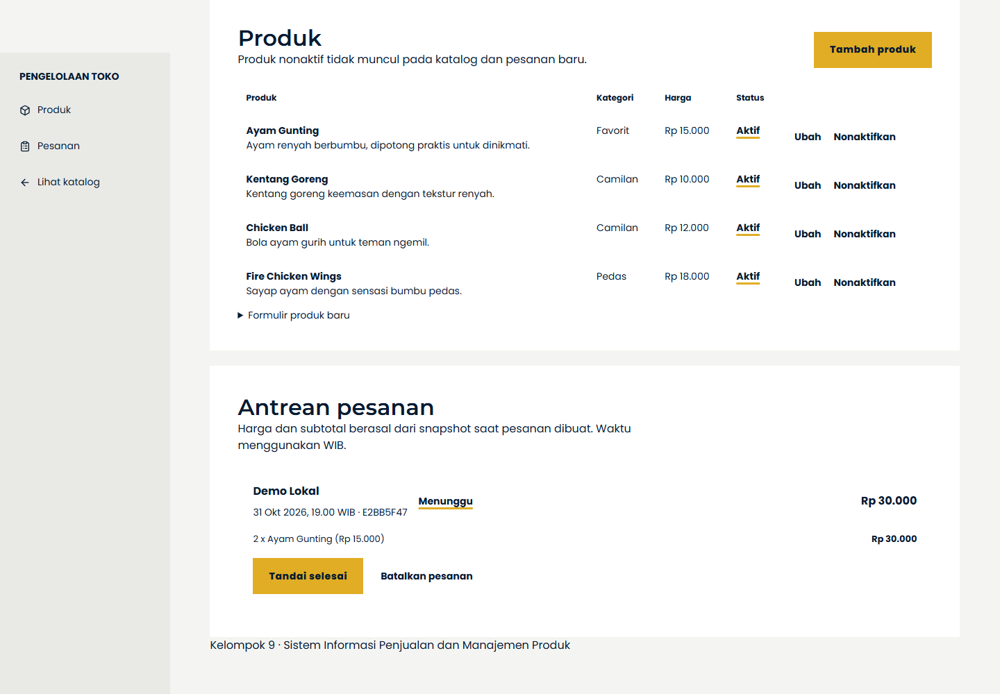

## 6. Wireframe

Wireframe diperbarui agar mengikuti struktur dan navigasi yang tampil pada aplikasi. Dokumen menggunakan frame desktop 1440 x 900, skala 86 persen untuk lembar anotasi, tampilan grayscale, serta area media placeholder. Wireframe menggambarkan tujuh layar atau state utama. SVG adalah sumber yang dapat disunting; PNG adalah pratinjau.

#### 6.1 Beranda katalog

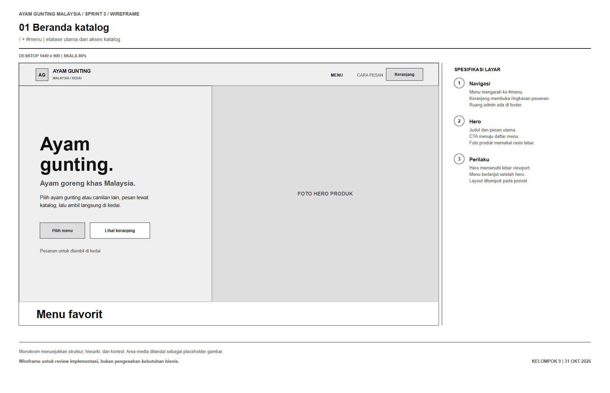

#### 6.2 Katalog produk

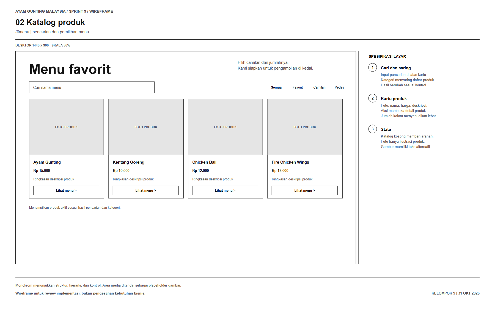

#### 6.3 Detail produk

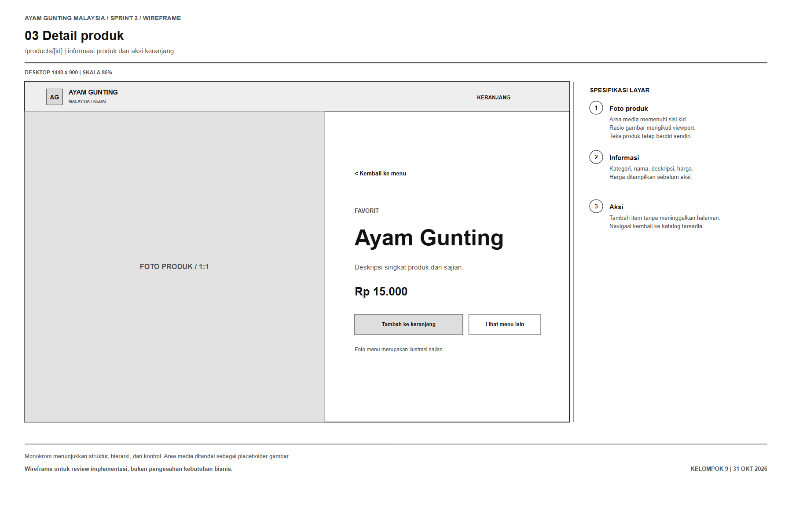

#### 6.4 Keranjang dan pesanan

#### 6.5 Tanda terima

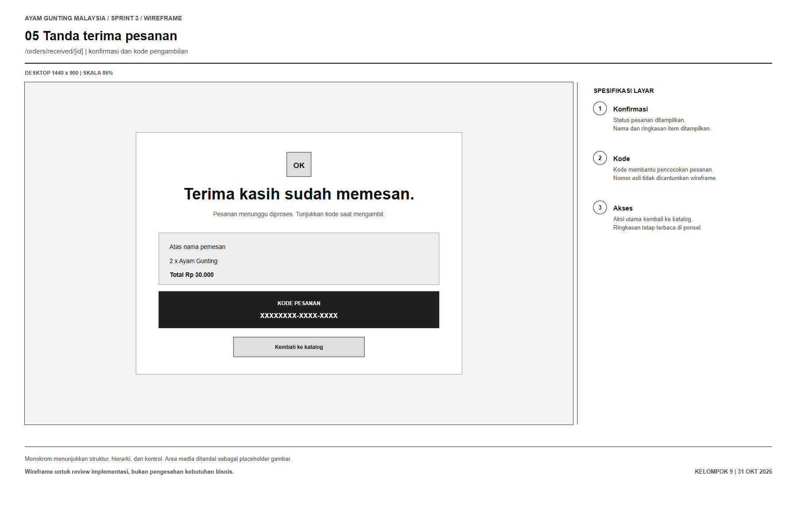

#### 6.6 Login admin

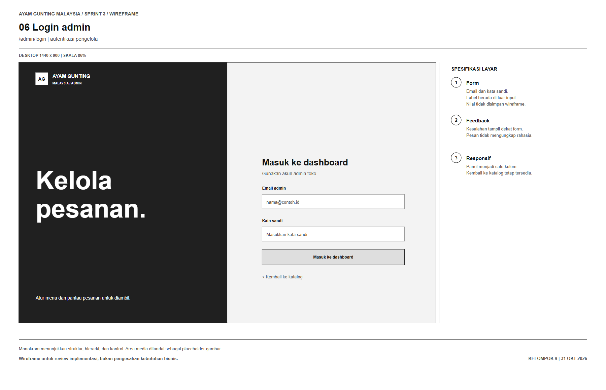

#### 6.7 Dashboard admin

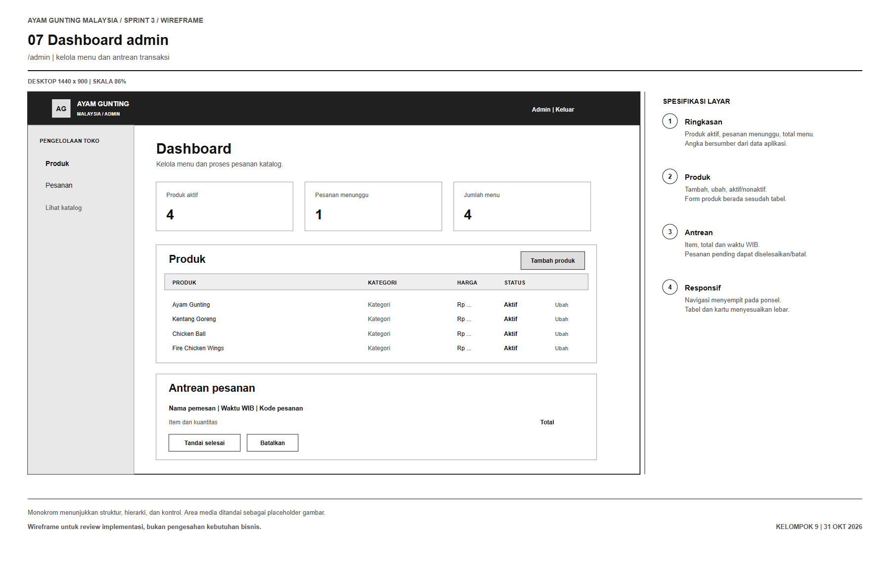

## 7. Pemeriksaan dan status verifikasi

| Pemeriksaan | Catatan per 31 Oktober 2026 |
|---|---|
| Peninjauan visual | Halaman beranda, katalog desktop dan ponsel, detail, dua state keranjang, tanda terima, login admin, dashboard, serta antrean ditangkap dari aplikasi lokal dan ditinjau secara visual |
| Pemeriksaan interaksi browser | Navigasi halaman dan autentikasi admin lokal digunakan untuk memperoleh tangkapan layar; dokumentasi ini bukan laporan uji end-to-end |
| TypeScript, lint, dan build | Tidak dijalankan ulang pada pembaruan dokumentasi ini; hasil sebelumnya tidak dijadikan klaim atas perubahan lokal terbaru |
| Database lokal | Data contoh tersedia pada komputer pengembangan; tidak disinkronkan antarperangkat |
| Migrasi Supabase | Belum diterapkan pada project Supabase |
| Uji perangkat dan penerimaan stakeholder | Belum dicatat |

## 8. Risiko dan tindak lanjut

| Tindak lanjut | Tujuan | Pemilik usulan |
|---|---|---|
| Tinjau nama produk, deskripsi, harga, dan aturan pengambilan dengan pemilik usaha | Mengganti data contoh dengan informasi yang disetujui | Nayla dan pemilik usaha |
| Jalankan pemeriksaan fungsional pada alur pesanan dan perubahan status admin | Memastikan perilaku aplikasi sesuai acceptance criteria | Faiza dan Niluh |
| Review dan terapkan migrasi pada project Supabase development | Memeriksa skema, RLS, RPC, dan akses admin | Faiza; Zahra meninjau model |
| Tambahkan rate limit atau CAPTCHA untuk pemesanan hosted | Mengurangi spam pada endpoint yang dapat diakses publik | Faiza |
| Catat kickoff, keputusan, review, dan persetujuan setelah kegiatan berlangsung | Menjaga bukti pelaksanaan tetap sesuai kejadian | Nayla dan seluruh anggota |

## 9. Referensi proyek

- [Rencana Sprint 3](SPRINT_PLAN.md)
- [Catatan eksekusi proyek](SPRINT_EXECUTION.md)
- [Serah terima implementasi](IMPLEMENTATION_HANDOFF.md)
- [Sprint tracker](../SPRINT_TRACKER.md)
- [Project backlog](../PROJECT_BACKLOG.md)
- [Pertanyaan terbuka](../OPEN_QUESTIONS.md)
